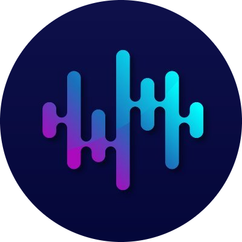

<div align="center">
  
  <h1>Solace</h1>
  <p>Multi-source Discord music system with dedicated management dashboards.</p>

  <p>
    <a href="#overview">Overview</a> &bull;
    <a href="#features">Features</a> &bull;
    <a href="#architecture">Architecture</a> &bull;
    <a href="#permissions">Permissions</a> &bull;
    <a href="#getting-started">Getting Started</a> &bull;
    <a href="#project-structure">Project Structure</a>
  </p>
</div>

---

## Overview

Solace is a modular Discord music application built with TypeScript and Lavalink v4. It provides low-latency audio playback from Spotify, YouTube Music, and SoundCloud across voice channels.

The system includes a dual dashboard interface:
- **Server Dashboard**: Allows guild administrators to manage DJ roles, audio settings, channel bindings, and queue controls.
- **Admin Console**: Provides instance telemetry, Lavalink node diagnostics, resource analytics, and debugging tools for the bot owner.

Solace supports both self-hosted deployment via Docker Compose and multi-tenant hosted configurations.

---

## Features

### Audio Playback
- Multi-source audio pipeline supporting Spotify, YouTube Music, and SoundCloud.
- Automated metadata resolution for Spotify tracks, albums, and playlists.
- Real-time digital signal processing (DSP) filters: Lofi, Bass Boost, Nightcore, and custom equalizers.
- 24/7 channel persistence and automatic reconnection handling.
- Comprehensive playback controls: seek, skip, shuffle, loop (track or queue), and volume normalization.

### User Interface
- Native Discord slash commands and component interactions (buttons, select menus).
- Embedded status displays with dynamic progress tracking.
- Configurable role-based permissions and vote-skip thresholds.

### Web Management
- Guild-level dashboard for server owners and administrators.
- Centralized monitoring dashboard for system operators and bot hosts.

---

## Architecture

Solace isolates audio decoding and network streaming to Lavalink v4, keeping the Discord gateway client lightweight and responsive.

```
                         [ Discord Gateway / API ]
                                     |
                         Events & Slash Commands
                                     v
[ Streaming Providers ] <----> [ Solace Bot Client ] <----> [ Web Dashboards ]
(Spotify, YTM, SoundCloud)           |                         (Next.js)
             |                       | IPC / Redis
             v                       v
       [ Lavalink v4 ] <-------------+
             |
        Opus Stream
             v
  [ Discord Voice Channel ]
```

---

## Permissions

Access control follows a 5-tier role hierarchy:

| Level | Role | Scope | Capabilities |
| :---: | :--- | :--- | :--- |
| 5 | Bot Owner | Global | System administration, diagnostics, and global settings. |
| 4 | Bot Admin | Global | Node inspection, telemetry review, and access controls. |
| 3 | Server Admin | Guild | Server configuration, channel binds, and DJ assignments. |
| 2 | DJ Role | Guild | Playback overrides, queue manipulation, and audio filters. |
| 1 | Member | Guild | Playback requests, personal queueing, and vote-skipping. |

---

## Project Structure

The repository is organized as a workspace monorepo:

```text
Solace/
├── apps/
│   ├── bot/            # Discord bot client and audio handlers
│   └── web/            # Next.js web dashboards
├── packages/
│   ├── database/       # Database schemas and client
│   └── shared/         # Common types, enums, and constants
├── lavalink/           # Lavalink server configuration
├── assets/             # Branding and icons
├── docker-compose.yml  # Deployment configuration
└── .env.example        # Environment variable definitions
```

---

## Getting Started

### Prerequisites
- Node.js 20.0.0 or higher
- Java 17 or higher (for Lavalink v4)
- Discord Application credentials (Bot Token, Client ID)
- Spotify API credentials (Client ID, Client Secret)

### Installation

1. Clone the repository:
   ```bash
   git clone https://github.com/senu-io/Solace.git
   cd Solace
   ```

2. Configure environment variables:
   ```bash
   cp .env.example .env
   ```

3. Install dependencies:
   ```bash
   npm install
   ```

4. Start the Lavalink node:
   ```bash
   cd lavalink
   java -jar Lavalink.jar
   ```

5. Start the bot:
   ```bash
   npm run dev:bot
   ```
